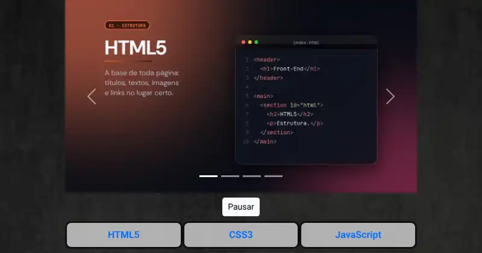
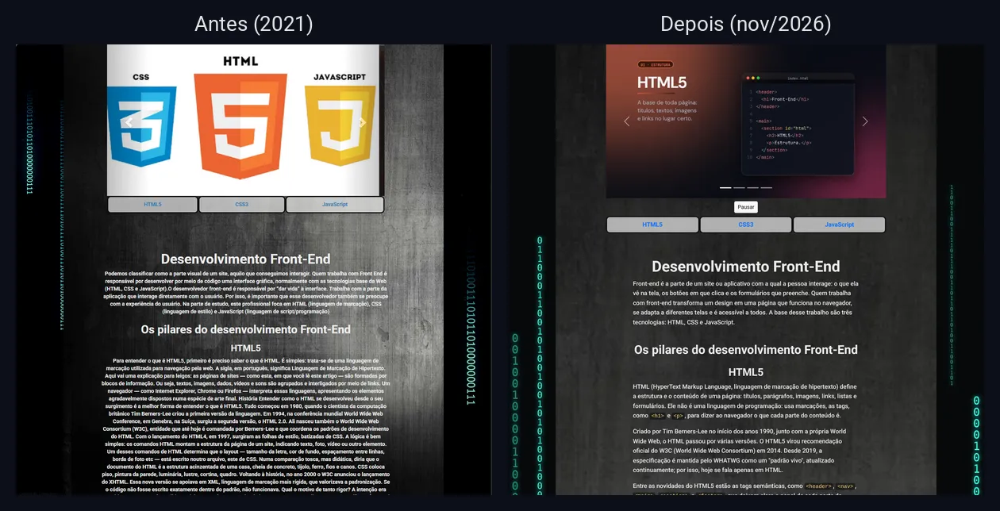

<h1 align="center">Images Carousel</h1>

<p align="center">
  Página responsiva sobre os pilares do desenvolvimento front-end (HTML5, CSS3 e JavaScript), com um carrossel de imagens acessível feito com Bootstrap 5.
</p>

<p align="center">
  <a href="https://carousel-paulobarboza93.vercel.app"><strong>Ver o site no ar</strong></a>
</p>

<p align="center">
  
</p>

## 💻 Sobre o projeto

A página mostra um carrossel com quatro imagens e, abaixo dele, um menu com três botões (HTML5, CSS3 e JavaScript). Cada botão leva à parte do texto sobre aquela tecnologia, com uma explicação curta e as fontes usadas no fim da página.

O carrossel troca de imagem a cada 3 segundos e pode ser pausado a qualquer momento.

## 🚀 Tecnologias

- HTML5
- CSS3
- JavaScript (sem jQuery)
- [Bootstrap 5.3](https://getbootstrap.com/), carregado por CDN
- Imagens em WebP

## ♿ Acessibilidade e desempenho

- Botão **Pausar/Continuar** para parar o carrossel, seguindo a regra 2.2.2 das WCAG (pausar, parar e ocultar).
- Se o sistema estiver configurado para **reduzir movimento**, o carrossel já começa parado e a rolagem não é animada.
- Texto alternativo (`alt`) descritivo em todas as imagens e rótulos nos botões do carrossel.
- O carrossel pausa quando o mouse está sobre ele.
- Imagens com largura e altura declaradas, para a página não "pular" enquanto carrega.

Notas do Lighthouse (medidas em nov/2026):

| | Desempenho | Acessibilidade | Boas práticas | SEO |
| --- | :---: | :---: | :---: | :---: |
| Celular | 97 | 100 | 100 | 100 |
| Computador | 100 | 100 | 100 | 100 |

## 🕓 Histórico de versões

**2021: versão original.** Carrossel com Bootstrap 3 e jQuery, imagens em PNG e JPG.

**Nov/2026: revisão.**
- Bootstrap 3 + jQuery trocados por Bootstrap 5.3, sem jQuery.
- Arquivos do site reduzidos de cerca de 5,4 MB para cerca de 245 KB (imagens em WebP e remoção de arquivos sem uso).
- Imagens novas no carrossel e no fundo com números binários.
- Botão de pausa, suporte a "reduzir movimento" e textos alternativos.
- Textos reescritos em parágrafos curtos, com as fontes no fim da página.
- Menu corrigido: cada botão leva à sua própria seção.

<p align="center">
  
</p>

## ▶️ Como rodar

Não precisa instalar nada.

```bash
git clone https://github.com/PauloBarboza93/Images-Carousel.git
cd Images-Carousel
```

Depois, é só abrir o arquivo `index.html` no navegador. É preciso estar conectado à internet, porque o Bootstrap e a fonte vêm por CDN.

## 📚 Créditos

- **Imagens:** as do carrossel, o fundo com números binários e o ícone da aba foram criados para este projeto. A textura escura atrás do texto vem da versão original de 2021, convertida para WebP.
- **Fonte:** [Roboto](https://fonts.google.com/specimen/Roboto), do Google Fonts (licença SIL Open Font License).
- **Textos:** baseados na documentação da MDN, da W3C e da Ecma International. Os links estão na seção "Fontes", no fim da página.

## 👤 Autor

Feito por **Paulo Oliveira**.

[LinkedIn](https://www.linkedin.com/in/paulo-oliveira-a2529b1a0/) · [GitHub](https://github.com/PauloBarboza93)
